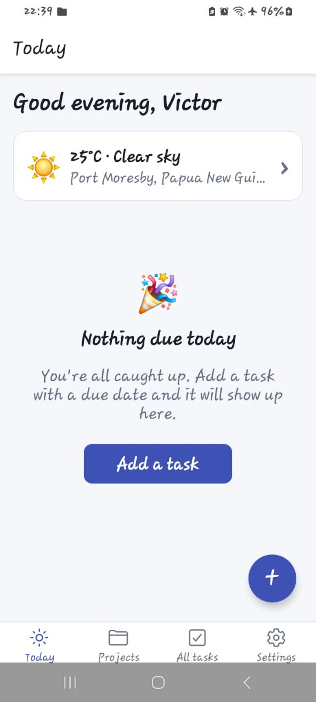
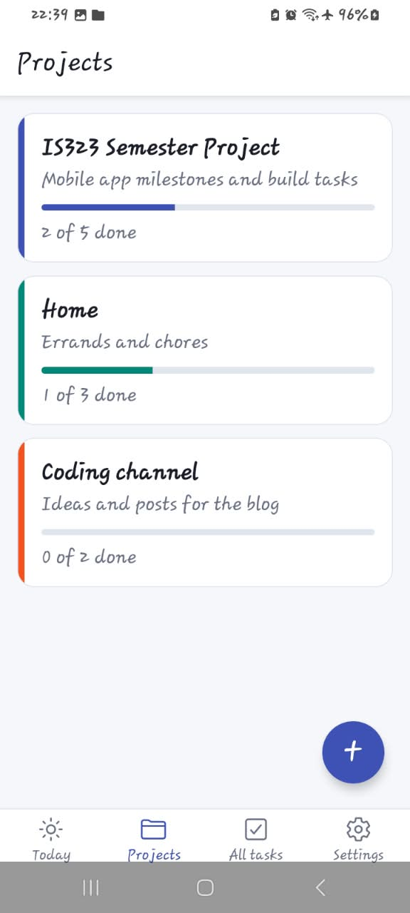
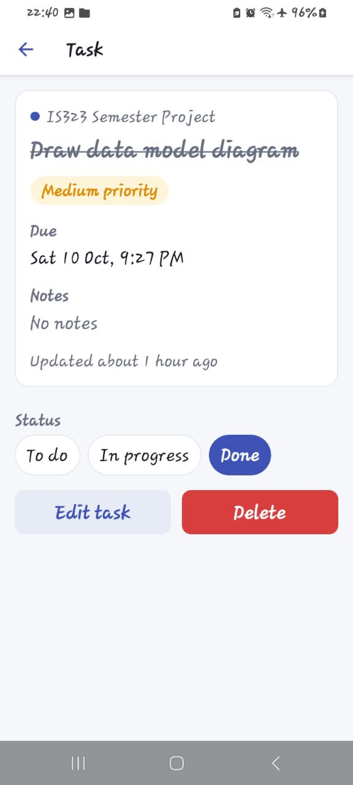
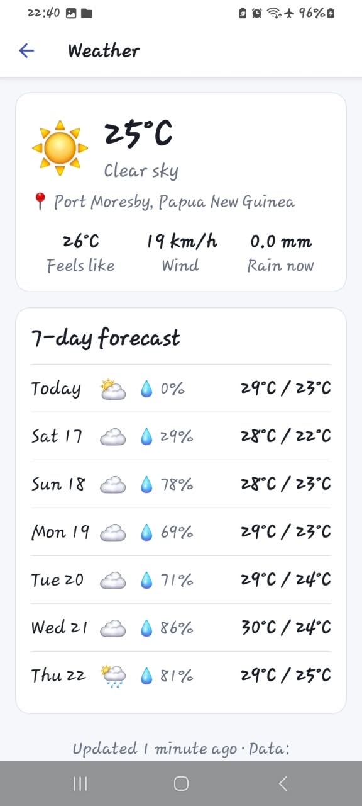

# TaskFlow

TaskFlow is an Android task manager for students and busy people. Users group their work into colour-coded **projects**, add **tasks** with priorities, statuses and due dates, and get a **reminder notification** on their phone before a task is due. The Today screen shows overdue and due-today tasks next to the **local weather forecast**, and warns when rain is likely on a day you have open tasks, so you can plan errands and travel around it. Data syncs through Supabase, so it survives reinstalling and appears on any device you sign in on; the last-loaded lists stay readable offline.

- **Student:** Victor Asipali — _[student number]_
- **Unit:** IS323 Mobile Application Development, PNG University of Technology
- **Stack:** React Native · Expo SDK 57 (managed) · Expo Router · TypeScript · Supabase · TanStack Query

---

## Features against the brief

| Requirement (brief §3)                               | Where it lives                                                                                                   |
| ---------------------------------------------------- | ---------------------------------------------------------------------------------------------------------------- |
| 6+ screens, 2 navigation patterns                    | 12 screens: tab navigator `app/(tabs)` + stack drill-down `app/project`, `app/task`, `app/weather.tsx`           |
| Register / log in / log out / session persistence    | `app/(auth)/*`, `src/context/AuthContext.tsx` (session stored in AsyncStorage)                                   |
| Protected routes                                     | `Stack.Protected` guards in `app/_layout.tsx` — signed-out users can't reach app screens even by deep link       |
| Password reset + email verification                  | `app/(auth)/forgot-password.tsx`, `register.tsx`                                                                 |
| 2 related entities                                   | `projects` 1 ──< `tasks` (see data model below)                                                                  |
| Full CRUD with validation + confirm-on-delete        | `app/project/form.tsx`, `app/task/form.tsx`, detail screens; zod schemas in `src/utils/validators.ts`            |
| Ownership enforced in the database                   | Row Level Security in `supabase/schema.sql`                                                                      |
| Local storage (complement)                           | Offline list cache, preferences, unsaved task drafts — `src/services/storageService.ts`                          |
| API 1 — Group A: Weather                             | Open-Meteo forecast from device GPS (or a typed city if permission is denied) — `src/services/weatherService.ts` |
| API 2 — Group B: Notifications                       | `expo-notifications` local scheduled reminders — `src/services/notificationService.ts`                           |
| Loading / success / empty / error on every data view | `src/components/StateView.tsx`, `OfflineBanner.tsx`                                                              |
| One theme file                                       | `src/theme/index.ts`                                                                                             |

## Data model

```
auth.users (Supabase)
   │ 1
   │
   ▼ many
projects ──────────────────────────────┐
  id          uuid  PK                 │ 1
  user_id     uuid  FK → auth.users    │
  name        text  (1–60 chars)       │
  description text  nullable           ▼ many
  color       text  (#RRGGBB)        tasks
  created_at  timestamptz              id          uuid  PK
  updated_at  timestamptz              user_id     uuid  FK → auth.users
                                       project_id  uuid  FK → projects (ON DELETE CASCADE)
                                       title       text  (1–120 chars)
                                       notes       text  nullable
                                       status      todo | in_progress | done
                                       priority    low | medium | high
                                       due_at      timestamptz nullable
                                       remind      boolean
                                       created_at, updated_at
```

Deleting a project deletes its tasks. Reminder notification IDs are device-specific, so they are kept in AsyncStorage, not the database.

## Screens

| Group | Screen                      | File                             |
| ----- | --------------------------- | -------------------------------- |
| Auth  | Log in                      | `app/(auth)/login.tsx`           |
| Auth  | Register                    | `app/(auth)/register.tsx`        |
| Auth  | Forgot password             | `app/(auth)/forgot-password.tsx` |
| Tabs  | Today (dashboard + weather) | `app/(tabs)/index.tsx`           |
| Tabs  | Projects list               | `app/(tabs)/projects.tsx`        |
| Tabs  | All tasks (filterable)      | `app/(tabs)/tasks.tsx`           |
| Tabs  | Settings                    | `app/(tabs)/settings.tsx`        |
| Stack | Project detail              | `app/project/[id].tsx`           |
| Stack | Create / edit project       | `app/project/form.tsx`           |
| Stack | Task detail                 | `app/task/[id].tsx`              |
| Stack | Create / edit task          | `app/task/form.tsx`              |
| Stack | Weather forecast            | `app/weather.tsx`                |

---

## Setup (from a clean clone)

**Prerequisites:** Node.js LTS, Git, an Expo account, a Supabase account, and Expo Go for **SDK 57** on an Android phone (install the matching APK from [expo.dev/go](https://expo.dev/go) if the Play Store version differs).

> ⚠️ This project is pinned to **Expo SDK 57**. If the class SDK announced in Week 1 is different, align it before starting feature work, and don't change it afterwards.

1. **Install dependencies**
   ```bash
   npm install
   ```
2. **Create the Supabase project**
   1. supabase.com → New project.
   2. SQL Editor → paste `supabase/schema.sql` → Run. This creates both tables and the RLS policies.
   3. Authentication → Sign In / Providers → Email: keep **Confirm email** on.
   4. Authentication → URL Configuration → add `taskflow://**` and `exp://**` to Redirect URLs.
3. **Environment variables**
   ```bash
   cp .env.example .env
   ```
   Fill in values from Supabase → Project Settings → API.
4. **Run in Expo Go**
   ```bash
   npx expo start
   ```
   Scan the QR code with Expo Go. If the phone can't connect, use `npx expo start --tunnel`.
5. **Seed the test account (optional)** — register a user in the app, confirm the email, edit the email in `supabase/seed.sql`, and run it in the SQL Editor.

### Required environment variables

| Name                            | Purpose                                                                           |
| ------------------------------- | --------------------------------------------------------------------------------- |
| `EXPO_PUBLIC_SUPABASE_URL`      | Your Supabase project URL                                                         |
| `EXPO_PUBLIC_SUPABASE_ANON_KEY` | Supabase **anon / publishable** key. Never use the `service_role` key in the app. |

Open-Meteo needs no key.

## External APIs and services

| Provider           | Used for                                                      | Endpoints                  | Limits                                           | On failure                                                                                          |
| ------------------ | ------------------------------------------------------------- | -------------------------- | ------------------------------------------------ | --------------------------------------------------------------------------------------------------- |
| Supabase Auth      | Register, log in, session, password reset, email verification | `supabase-js` auth methods | Free-tier email rate limits                      | Inline form error with a readable message                                                           |
| Supabase Postgres  | Projects and tasks CRUD                                       | REST via `supabase-js`     | Free-tier quotas                                 | Lists fall back to the cached copy with an offline banner; otherwise error state with **Try again** |
| Open-Meteo         | Current conditions + 7-day forecast; rain alert on Today      | `GET /v1/forecast`         | ~10,000 calls/day fair use; cached 15 min in-app | 12 s timeout, HTTP 429 handled, falls back to the last saved forecast                               |
| expo-location      | Device coordinates, reverse geocoding, city lookup            | Device API                 | —                                                | Permission denied → user types a city instead                                                       |
| expo-notifications | Local reminder before a task's due time                       | Device scheduler           | Local only (no remote push in Expo Go)           | Task still saves; user is told the reminder wasn't set                                              |

## Scripts

```bash
npm start           # expo start
npm run typecheck   # tsc --noEmit
npm run lint        # expo lint (ESLint + eslint-config-expo)
npm run format      # prettier --write .
```

---

## Building the APK and AAB (EAS)

`eas.json` defines three profiles: `development` (optional dev client), `preview` (installable **APK** — submit this), and `production` (**AAB** for Google Play).

```bash
npm install -g eas-cli
eas login
eas init                       # links the project; adds extra.eas.projectId to app config

# EXPO_PUBLIC_ values in .env are NOT sent to cloud builds. Store them on EAS
# for the environments the preview and production profiles use (eas-cli 24+):
eas env:set --environment preview --environment production \
  --name EXPO_PUBLIC_SUPABASE_URL --value https://xxxx.supabase.co --visibility plaintext
eas env:set --environment preview --environment production \
  --name EXPO_PUBLIC_SUPABASE_ANON_KEY --value <anon-key> --visibility sensitive

eas build --platform android --profile preview      # → .apk
eas build --platform android --profile production   # → .aab
eas build:list
```

Verify these commands against the current [EAS docs](https://docs.expo.dev/build/introduction/) before building; EAS tooling changes quickly. A missing env var shows up as the login screen warning "Supabase is not configured" in the APK.

- **Package name:** `com.victorasipali.taskflow` (permanent once published).
- **Version code** is managed remotely by EAS (`appVersionSource: remote`, `autoIncrement` on production).
- **Signing:** EAS generates the upload keystore on the first build. Back it up with `eas credentials`. Never commit it.
- **Testing the AAB:** `bundletool build-apks --bundle=app.aab --output=app.apks --mode=universal`.
- **Local builds** (no quota): `eas build --platform android --profile preview --local` (needs Android SDK + JDK).

---

## Screenshots

| Today            | Projects         | Task detail      | Weather          |
| ---------------- | ---------------- | ---------------- | ---------------- |
| _add screenshot_ | _add screenshot_ | _add screenshot_ | _add screenshot_ |

 |  |  |  |

## Known limitations

- Reminders are scheduled on the device that saved the task. A second phone signed in as the same user won't ring until the task is saved on that phone too.
- Offline mode is read-only: cached lists are viewable, but creating or editing needs a connection.
- The weather alert uses the forecast for your current location, not a per-task location.
- Signing out clears this device's cached lists and scheduled reminders.
- Tested on Android only; iOS was not part of the brief.

## Scope decisions (what I cut)

- _Record here the features you dropped and why, e.g. task sharing, sub-tasks, image attachments._

## AI assistance

- _State honestly which AI tools you used and for what (brief §9). You must be able to explain every line in the lab without notes._

## Credits

Open-source libraries: Expo, Expo Router, React Native, Supabase JS, TanStack Query, zod, date-fns, @react-native-community/datetimepicker, @react-native-community/netinfo, @react-native-async-storage/async-storage. Weather data by [Open-Meteo.com](https://open-meteo.com/) (CC BY 4.0).
